# FIAP — Faculdade de Informática e Administração Paulista

<p align="center">
  <a href="https://www.fiap.com.br/">
    
  </a>
</p>

<br>
<h2 align="center">CardioIA Conectada: IoT e Visualização de Dados para a Saúde Digital</h2>

<p align="center">
  <strong>Aluno:</strong> Richard Schmitz &nbsp;|&nbsp; <strong>RM:</strong> 567951<br>
  <strong>Curso EAD:</strong> Inteligência Artificial - FIAP &nbsp;|&nbsp; <strong>Fase:</strong> 3  Pulso: Inteligência Cardiológica com Consciência de Dados
</p>

---

## Vídeo de demonstração

> **[Demonstração completa - Fase 3](LINK_DO_VIDEO_AQUI)**
> Postado no YouTube como "não listado". Demonstra o Pulso Band no Wokwi, o fluxo MQTT até o broker público do HiveMQ, o dashboard no Node-RED e a automação REST + e-mail.

# Repositório da Fase 3: github.com/flango2023/Pulso_F3

---

# Pulso Fase 3: Monitoramento Contínuo — IoT na Saúde

O Pulso simula o ecossistema de dados de uma plataforma de cardiologia inteligente. Ao longo de sete fases, o projeto integra Machine Learning, IoT, Visão Computacional, NLP e séries temporais aplicados à saúde cardiovascular.

Esta é a Fase 3: o **Pulso Band**, um dispositivo vestível simulado que captura sinais vitais, processa dados na borda (Edge), transmite para a nuvem via MQTT e exibe tudo em um dashboard com alertas automáticos.

---

## Continuidade com as Fases 1 e 2

A Fase 3 materializa o eixo de wearable/IoT que vinha sendo preparado desde o início:

- Na **Fase 1**, o dataset foi documentado com foco no monitoramento contínuo, e variáveis como a frequência cardíaca (`thalach` do UCI Cleveland) já indicavam sinais que um wearable capturaria.
- Na **Fase 2**, o diagnóstico assistido por IA utilizou dados estáticos. Agora, o Pulso Band gera o fluxo de dados **em tempo real** que, nas fases seguintes, alimentará os modelos preditivos de séries temporais (Fase 6).
- O **Pulso Band** é o dispositivo físico (simulado) que faz a ponte entre o paciente e a plataforma: é a origem dos sinais vitais que todo o ecossistema CardioIA consome.

---

## Eixo temático

O Pulso é construído em torno de uma questão de governança em saúde: **tecnologia de monitoramento só tem valor clínico se for confiável quando mais importa** — ou seja, fora do hospital, em deslocamento, sem conexão garantida.

Por isso, a Fase 3 trata da resiliência offline, da segurança na transmissão e de limites de alerta clinicamente justificados não como detalhes técnicos, mas como requisitos de responsabilidade. Um wearable cardíaco que perde dados quando a rede cai, ou que dispara alertas arbitrários, não é um produto de saúde — é um risco.

---
---

## Estrutura do repositório

```
Pulso_F3/
│
├── README.md
│
├── src/
│   └── pulso_band.ino              ← Firmware do ESP32 (C++ comentado)
│
├── wokwi/
│   ├── diagram.json                ← Circuito: ESP32 + DHT22 + botão
│   └── libraries.txt               ← Bibliotecas a instalar no Wokwi
│
├── node-red/
│   └── flow.json                   ← Dashboard (importar no Node-RED)
│
├── iralem1/
│   ├── pulso_api.py                ← API REST (Flask)
│   ├── pulso_client.py             ← Cliente REST + risco + e-mail
│   └── requirements.txt            ← Dependências Python
│
├── docs/
│   ├── relatorio_parte1_edge.md    ← Relatório Edge Computing (mín. 1 pg)
│   ├── relatorio_parte2_mqtt.md    ← Relatório MQTT + dashboard (mín. 2 pg)
│   └── relatorio_iralem1_rest.md   ← Relatório Ir Além 1 (1–2 pg)
│
└── assets/
    └── (prints do Wokwi, dashboard e broker — adicionados após execução)
```

---

## Arquitetura da solução

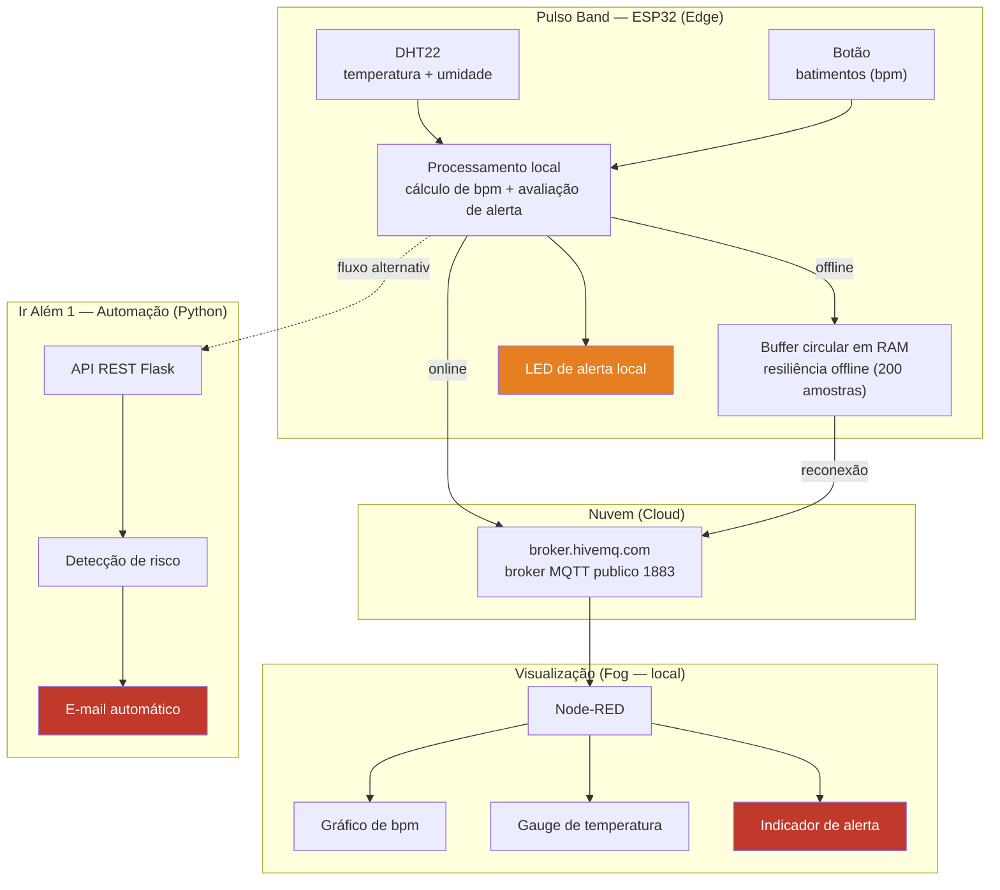

---

## Fluxo de dados ponta a ponta

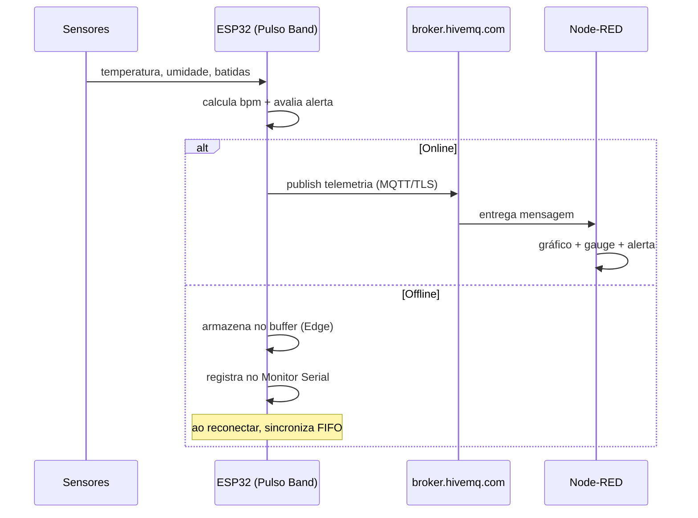


## Parte 1 — Armazenamento e processamento local (Edge Computing)

O **Pulso Band** roda em ESP32 no Wokwi com dois sensores distintos:

| Sensor | Pino | Mede | Papel |
|---|---|---|---|
| DHT22 | GPIO 15 | Temperatura + umidade | Sensor obrigatório |
| Botão | GPIO 4 | Batimentos (bpm) | Segundo sensor — sinal vital |

**Resiliência offline:** quando a conexão cai, as leituras são armazenadas em um
buffer circular em RAM (200 amostras ≈ 16,6 minutos offline, ~3% da RAM do ESP32).
Ao reconectar, o buffer é sincronizado em ordem FIFO e cada leitura só é removida
após envio confirmado. O SPIFFS não é usado por ser volátil no simulador; o Monitor
Serial evidencia o acúmulo offline, conforme sugerido pelo enunciado.

**Limites de alerta clinicamente justificados:** bpm > 100 (taquicardia, AHA) e
temperatura > 37,8 °C (limiar de febre).

Detalhes completos e o cálculo de dimensionamento do buffer em
[`docs/relatorio_parte1_edge.md`](docs/relatorio_parte1_edge.md).

### Link do projeto no Wokwi

> **Projeto no Wokwi:** https://wokwi.com/projects/479698369212437505

Para rodar no Wokwi: criar um projeto ESP32, colar `src/pulso_band.ino` como
`sketch.ino`, colar `wokwi/diagram.json` como `diagram.json` e instalar as
bibliotecas listadas em `wokwi/libraries.txt`.

### Evidências de execução

**Circuito e código no Wokwi** — ESP32 + DHT22 (GPIO 15) + botão (GPIO 4), simulação em execução:

<p align="center">
  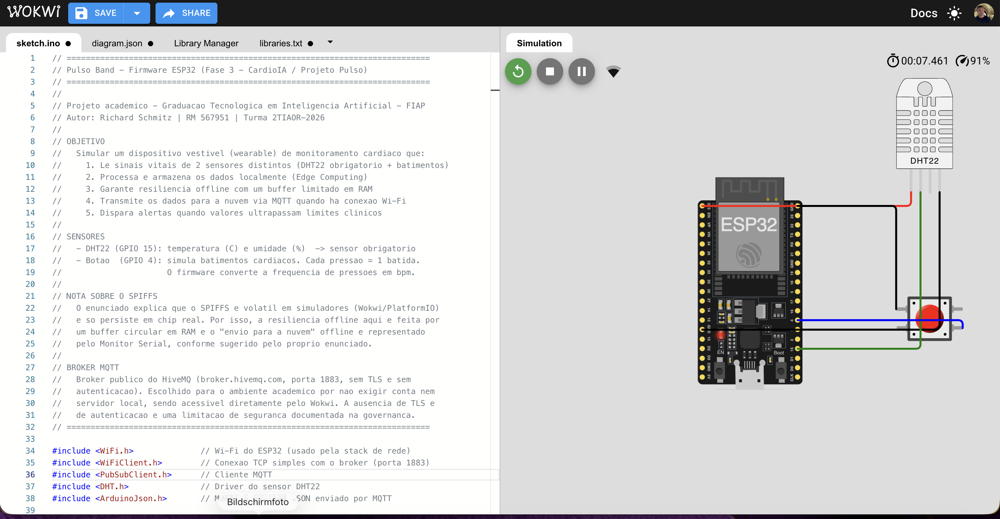
</p>

**Conexões (diagram.json) e pinos do ESP32:**

<p align="center">
  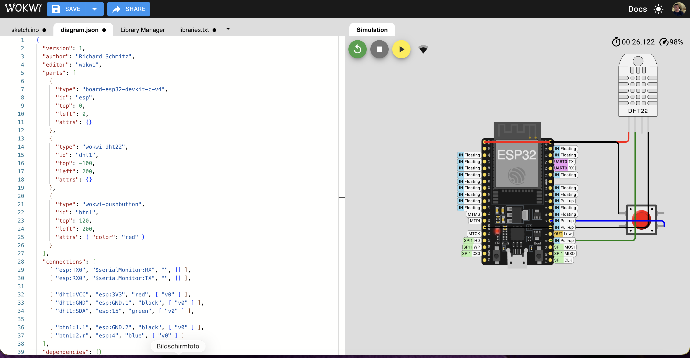
</p>

**Bibliotecas instaladas** (DHT sensor library, Adafruit Unified Sensor, PubSubClient, ArduinoJson):

<p align="center">
  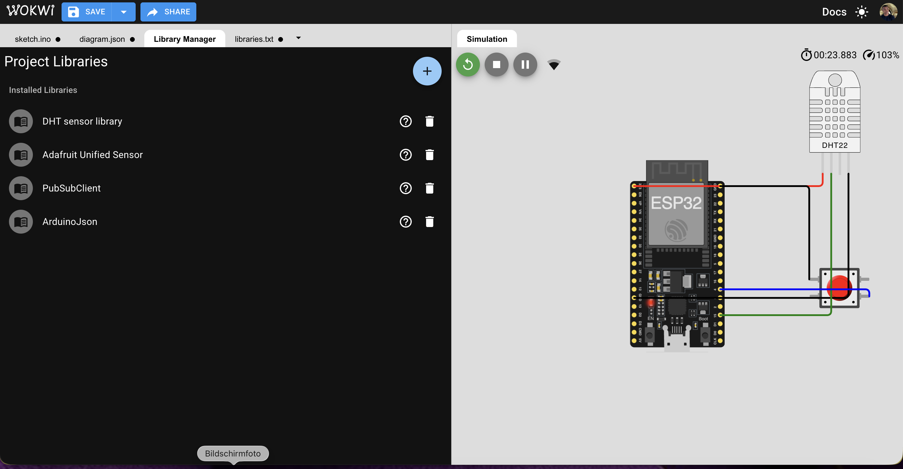
</p>

**Tráfego de rede Wi-Fi na simulação** (o ESP32 transmitindo dados):

<p align="center">
  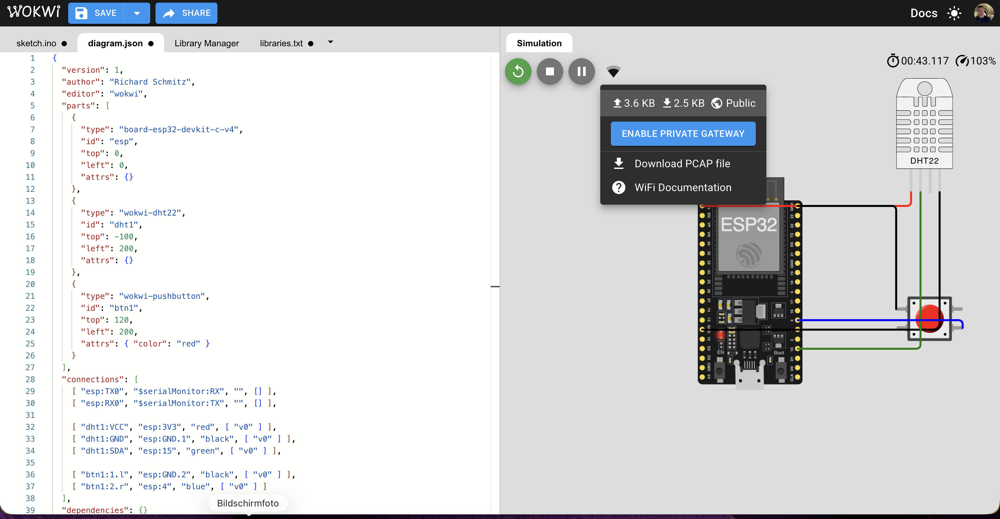
</p>

---

## Parte 2 — Transmissão para nuvem e visualização (Fog/Cloud)

O ESP32 publica os sinais vitais no **broker público do HiveMQ**
(`broker.hivemq.com`, porta 1883) e o **Node-RED** (local) assina os tópicos e
exibe o dashboard em tempo real.

| Tópico MQTT | Conteúdo |
|---|---|
| `pulso/band/rm567951/telemetria` | temperatura, umidade, bpm, alerta |
| `pulso/band/rm567951/alerta` | evento de alerta quando limites são ultrapassados |

**Dashboard (Node-RED):**
- **Gráfico de linha** — batimentos cardíacos (bpm) ao longo do tempo
- **Gauge** — temperatura, com faixas de cor
- **Indicador de alerta** — texto verde (normal) / vermelho (alerta) quando
  `bpm > 100` ou `temperatura > 37,8 °C`

Para rodar o dashboard:

```bash
npm install -g node-red
node-red                       # http://localhost:1880  (dashboard em /ui)
```

Depois, instalar `node-red-dashboard` em *Manage palette* e importar
`node-red/flow.json`. O flow já aponta para o broker público `broker.hivemq.com`,
sem credenciais a preencher.

### Evidência de execução — fluxo Node-RED conectado ao broker

O flow importado, com o nó MQTT em estado **connected** ao broker HiveMQ público,
o parse do JSON e os três widgets do dashboard (gráfico de bpm, gauge de
temperatura e indicador de alerta):

<p align="center">
  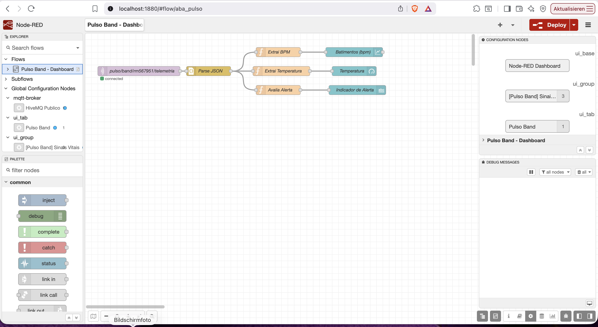
</p>

**Dashboard em funcionamento** (`localhost:1880/ui`) — com o gráfico de batimentos,
o gauge de temperatura (24 °C) e o indicador de status exibindo "Normal: 0 bpm / 24 C"
a partir dos dados reais recebidos do ESP32 via MQTT:

<p align="center">
  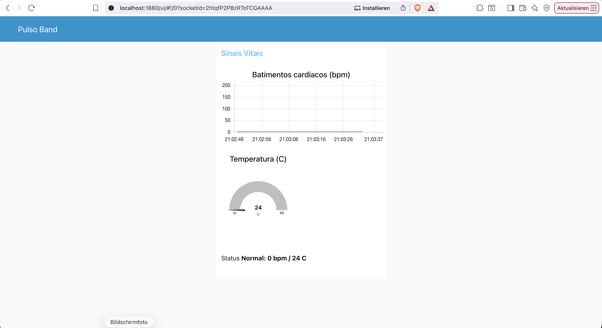
</p>

**Leitura do DHT22 no Wokwi** — valores de temperatura (24 °C) e umidade (40%)
ajustáveis durante a simulação:

<p align="center">
  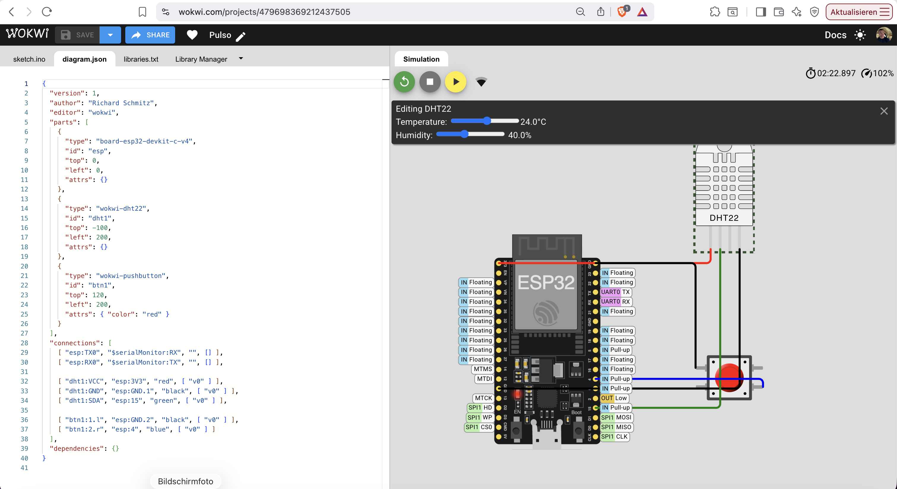
</p>

<details>
<summary>Configuração dos widgets do dashboard (chart e gauge)</summary>

Gráfico de batimentos (line chart, eixo Y 0–200 bpm):

<p align="center">
  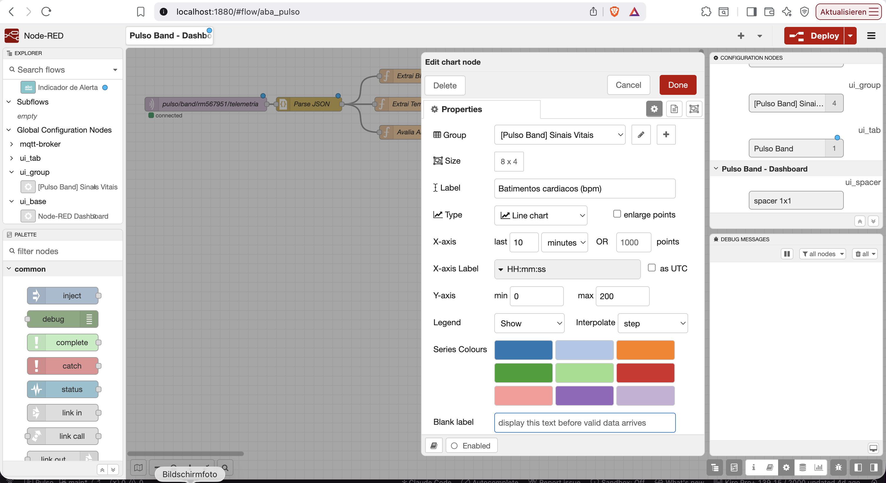
</p>

Gauge de temperatura (faixa 30–45 °C, setores verde/amarelo/vermelho a partir de 37,8 °C):

<p align="center">
  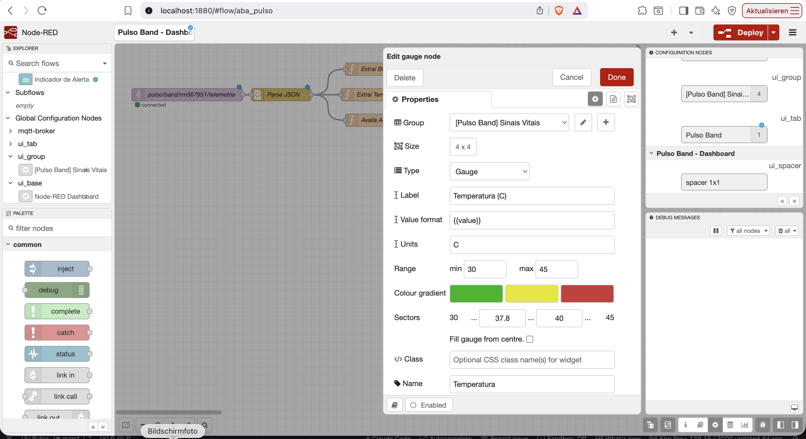
</p>

</details>

Detalhes do protocolo MQTT, QoS, segurança e configuração do dashboard em
[`docs/relatorio_parte2_mqtt.md`](docs/relatorio_parte2_mqtt.md).

---

## Ir Além 1 — Comunicação automatizada com REST e e-mail

Sistema em Python que envia e recebe sinais vitais por uma API REST, detecta riscos
(taquicardia, bradicardia, febre, ausência de movimento) e dispara um e-mail
automático em caso de alerta — RPA aplicado à saúde digital.

```bash
cd iralem1
pip install -r requirements.txt

# Terminal 1 — sobe a API
python pulso_api.py            # http://localhost:5001

# Terminal 2 — roda o cliente
python pulso_client.py
```

O envio de e-mail opera em modo simulação por padrão (`MODO_SIMULACAO = True`),
imprimindo a mensagem no console — reproduzível sem credenciais. O modo real via
SMPT/TLS está implementado e documentado.

Os cinco cenários testados (estável, taquicardia, febre, ausência de movimento,
bradicardia) acionaram a lógica corretamente. Detalhes em
[`docs/relatorio_iralem1_rest.md`](docs/relatorio_iralem1_rest.md).

---

## Governança e limitações

Seguindo o eixo de Responsible AI do projeto, as limitações são registradas de
forma explícita:

- Os sinais vitais são **simulados** (sensores no Wokwi e leituras geradas) e não
  representam pacientes reais.
- A temperatura do DHT22 é de pele/ambiente do dispositivo, **não** temperatura
  corporal central — o limite de 37,8 °C é didático.
- O broker MQTT é **público e sem TLS/autenticação** (`broker.hivemq.com:1883`):
  qualquer pessoa pode assinar os tópicos. Escolha consciente para o ambiente
  acadêmico (dados simulados, sem informação real de paciente), com caminho de
  endurecimento documentado no relatório da Parte 2 (migração para TLS 8883 +
  autenticação). Os tópicos usam o prefixo do RM para isolar as mensagens.
- O envio de e-mail do Ir Além 1 roda em modo simulação por padrão, sem expor
  credenciais SMTP reais.

### Rastreabilidade dos artefatos

Diferenciando o que está no repositório do que é gerado em execução (ponto
destacado na avaliação da Fase 2):

| Artefato | No repositório | Gerado/configurado em execução |
|---|---|---|
| Firmware, circuito, flow, código Python | Sim | — |
| Relatórios | Sim | — |
| Buffer de resiliência | — | RAM do ESP32 (runtime) |
| Broker MQTT | `broker.hivemq.com` (público, no código) | Conexão estabelecida em runtime |
| Prints do Wokwi e Node-RED (`assets/`) | Sim | Capturados durante a execução real |
| Link do projeto no Wokwi | Sim (no README) | — |

Nenhum componente desta fase deve ser utilizado para monitoramento clínico real.

---

## Aviso importante

Este projeto é acadêmico e tem finalidade exclusivamente educacional. Os dados,
dispositivos e automações produzidos não devem ser utilizados para diagnóstico,
monitoramento ou qualquer decisão clínica relacionada à saúde de pacientes reais.
Nenhum componente foi validado clinicamente.

---

## Autor

Richard Schmitz
Graduação Tecnológica em Inteligência Artificial — FIAP
Turma 2TIAOR-2026

GitHub: https://github.com/flango2023

LinkedIn: https://www.linkedin.com/in/richard-schmitz01/
