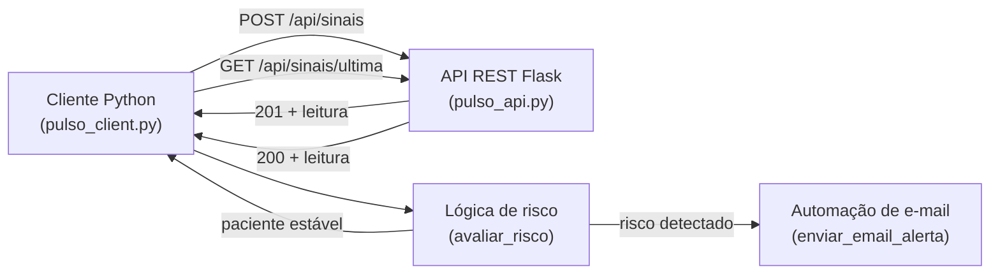

# Relatório Ir Além 1 — Comunicação automatizada com REST e e-mail

**Projeto:** Pulso — Inteligência Cardiológica com Consciência de Dados
**Fase 3:** Monitoramento Contínuo — IoT na Saúde
**Autor:** Richard Schmitz — RM 567951 — Turma 2TIAOR-2026

---

## 1. Objetivo

Simular um sistema de monitoramento que envia e recebe sinais vitais por uma API
REST em Python, aplica uma lógica de detecção de riscos e aciona uma automação de
envio de e-mail em caso de alerta. O exercício conecta três conceitos: o protocolo
HTTP, bibliotecas Python (Flask e requests) e a ideia de RPA (automação de um
processo que um operador humano faria manualmente — avisar a equipe clínica).

---

## 2. Arquitetura do fluxo



O sistema tem dois componentes:

- **`pulso_api.py`** — servidor REST (Flask) que simula o endpoint de nuvem. Recebe
  leituras via POST e as disponibiliza via GET.
- **`pulso_client.py`** — cliente que envia leituras, recupera a última registrada,
  avalia o risco e dispara o e-mail quando necessário.

---

## 3. API REST

| Método | Rota | Função |
|---|---|---|
| GET | `/health` | Verifica se o serviço está no ar |
| POST | `/api/sinais` | Recebe uma leitura (JSON) e a armazena |
| GET | `/api/sinais` | Lista todas as leituras |
| GET | `/api/sinais/ultima` | Retorna a leitura mais recente |

A API valida os campos obrigatórios (`bpm`, `temperatura`) e retorna erro 400 se o
corpo JSON estiver ausente ou incompleto. O armazenamento é em memória, suficiente
para a simulação — em produção seria um banco de dados ou um time-series store.

---

## 4. Lógica de detecção de risco

A função `avaliar_risco()` examina cada leitura e retorna a lista de condições
detectadas. Uma lista vazia significa paciente estável.

| Condição | Regra | Fundamento |
|---|---|---|
| Taquicardia | bpm > 100 | FC elevada em repouso (AHA) |
| Bradicardia | bpm < 40 | FC muito baixa, possível risco |
| Febre | temperatura > 37,8 °C | Limiar de febre |
| Ausência de movimento | movimento == False | Possível queda ou desmaio no wearable |

A inclusão da "ausência de movimento" conecta com o eixo do projeto: em um
wearable, a parada de movimento combinada a sinais alterados é um indicador
relevante de evento agudo, especialmente em pacientes idosos ou com histórico
cardíaco.

---

## 5. Automação de e-mail (RPA)

Em caso de risco, `enviar_email_alerta()` monta uma mensagem com os dados da
leitura e as condições detectadas, e dispara o e-mail para a equipe clínica.

O envio opera em dois modos, controlados pela constante `MODO_SIMULACAO`:

- **`True` (padrão):** imprime o e-mail completo no console. Não exige credenciais
  nem conexão SMTP, o que torna a entrega acadêmica reproduzível por qualquer
  avaliador sem configuração adicional.
- **`False`:** envia de verdade via SMTP com TLS (porta 587), usando senha de app.

Essa separação é uma decisão de engenharia: o comportamento é idêntico nos dois
modos, mudando apenas o canal de saída. Isso permite demonstrar a automação sem
expor credenciais reais no repositório.

---

## 6. Execução e resultado obtido

O sistema foi executado com cinco leituras simuladas cobrindo todos os cenários:

```bash
# Terminal 1
python pulso_api.py       # sobe em http://localhost:5001

# Terminal 2
python pulso_client.py
```

Resultado da execução (resumido):

| Leitura | bpm | temp | movimento | Resultado |
|---|---|---|---|---|
| 1 | 78 | 36,5 | sim | Estável — sem alerta |
| 2 | 132 | 37,1 | sim | Taquicardia — e-mail disparado |
| 3 | 88 | 38,4 | sim | Febre — e-mail disparado |
| 4 | 90 | 36,8 | não | Ausência de movimento — e-mail disparado |
| 5 | 36 | 36,2 | sim | Bradicardia — e-mail disparado |

Os quatro cenários de risco acionaram o e-mail corretamente; o cenário estável não
gerou alerta. A lógica de detecção funcionou como esperado em todos os casos.

> Observação: a porta foi definida como 5001 em vez de 5000 porque, no macOS, a
> porta 5000 é ocupada pelo AirPlay Receiver. Documentado para reprodutibilidade.

---

## 7. Conexão com o restante da Fase 3

Este módulo é complementar ao fluxo MQTT da Parte 2. Enquanto o MQTT é ideal para
streaming contínuo de telemetria, a API REST representa o padrão de integração
ponto a ponto — por exemplo, um sistema hospitalar que consulta a última leitura de
um paciente ou registra um evento. A automação de e-mail demonstra como a camada de
software sobre o IoT pode acionar respostas humanas sem intervenção manual, que é a
essência do RPA aplicado à saúde digital.

---

## 8. Artefatos

| Artefato | Localização |
|---|---|
| Servidor REST | `iralem1/pulso_api.py` |
| Cliente + risco + e-mail | `iralem1/pulso_client.py` |
| Dependências | `iralem1/requirements.txt` |
