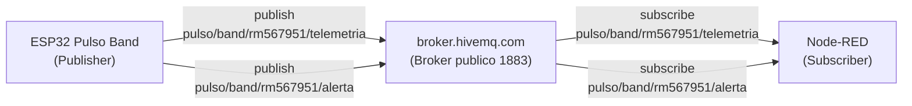
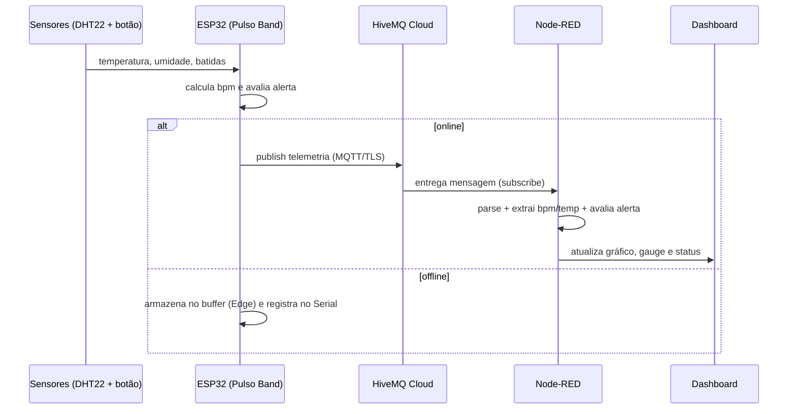

# Relatório Parte 2 — Transmissão para nuvem e visualização (Fog/Cloud Computing)

**Projeto:** Pulso — Inteligência Cardiológica com Consciência de Dados
**Fase 3:** Monitoramento Contínuo — IoT na Saúde
**Dispositivo:** Pulso Band (wearable cardíaco simulado)
**Autor:** Richard Schmitz — RM 567951 — Turma 2TIAOR-2026

---

## 1. Visão geral

Esta parte conecta o dispositivo de borda (ESP32) à nuvem e à camada de
visualização, completando o ciclo de dados da aplicação de IoT em saúde:

```
ESP32 (Pulso Band)  →  MQTT / TLS  →  HiveMQ Cloud (broker)  →  Node-RED  →  Dashboard
```

O ESP32 publica os sinais vitais em um broker MQTT público (broker.hivemq.com). O
Node-RED, rodando localmente, assina os tópicos do broker, processa as mensagens
e exibe os dados em um dashboard em tempo real com gráfico, medidor (gauge) e
indicador de alerta.

---

## 2. Arquitetura de comunicação MQTT

### Por que MQTT

O MQTT (Message Queuing Telemetry Transport) é o protocolo padrão de IoT porque
foi desenhado para dispositivos com recursos limitados e redes instáveis —
exatamente o cenário de um wearable. Características que o tornam adequado:

- **Leve:** cabeçalho mínimo, baixo consumo de banda e energia.
- **Publish/Subscribe:** desacopla quem produz dados (o ESP32) de quem consome
  (o dashboard). O dispositivo não precisa saber quem está escutando.
- **QoS:** níveis de garantia de entrega adequados a dados críticos de saúde.

### Modelo publish/subscribe aplicado ao Pulso Band



### Tópicos utilizados

O prefixo inclui o RM do autor para evitar colisão com outros usuários do broker
público, que é compartilhado por qualquer pessoa na internet.

| Tópico | Direção | Conteúdo |
|---|---|---|
| `pulso/band/rm567951/telemetria` | ESP32 → broker | JSON com temperatura, umidade, bpm, alerta |
| `pulso/band/rm567951/alerta` | ESP32 → broker | JSON com evento de alerta quando limites são ultrapassados |

### Formato do payload (telemetria)

```json
{
  "timestamp": 125000,
  "temperatura": 37.1,
  "umidade": 48.0,
  "bpm": 132,
  "alerta": true
}
```

O payload é montado com a biblioteca ArduinoJson e publicado a cada leitura quando
o dispositivo está online.

### Qualidade de serviço (QoS)

Para a telemetria usamos **QoS 1 (at least once)**: garante que cada leitura chega
ao broker ao menos uma vez, aceitando a possibilidade de duplicata. Em
monitoramento de saúde, perder uma leitura é pior do que recebê-la duplicada — o
dashboard lida bem com eventuais repetições, mas não com lacunas.

### Segurança da conexão

A conexão usa o broker público do HiveMQ (`broker.hivemq.com`) na **porta 1883
(TCP, sem TLS e sem autenticação)**.

**Limitação de segurança registrada:** o broker público não oferece criptografia
nem controle de acesso — qualquer pessoa pode assinar os tópicos. Em um produto
real de saúde, isso seria inaceitável: os dados do paciente trafegariam abertos.
A escolha foi deliberada para o contexto acadêmico, por três razões: (1) não exige
criação de conta nem servidor local, (2) é diretamente acessível pelo ESP32
simulado no Wokwi, e (3) os dados são simulados, sem informação real de paciente.

**Caminho de endurecimento em produção:** migrar para um broker com TLS na porta
8883 e autenticação por usuário/senha (HiveMQ Cloud, EMQX Cloud ou um broker
Mosquitto próprio com certificado), e restringir a permissão dos tópicos por
credencial. O código foi estruturado para que essa migração exija apenas trocar o
host, a porta e o tipo de socket de rede.

---

## 3. Configuração do broker — HiveMQ público

O projeto usa o broker público de testes do HiveMQ, que dispensa qualquer
configuração de conta ou servidor:

| Parâmetro | Valor |
|---|---|
| Host | `broker.hivemq.com` |
| Porta | `1883` (TCP, sem TLS) |
| Autenticação | nenhuma |

Esse endereço é mantido pelo HiveMQ como broker aberto para testes e é acessível
diretamente pela internet, o que permite que o ESP32 simulado no Wokwi se conecte
sem expor portas locais. Como o broker é compartilhado, os tópicos usam o prefixo
`pulso/band/rm567951/` para isolar as mensagens deste projeto.

---

## 4. Configuração do dashboard — Node-RED

### Instalação

O Node-RED roda localmente sobre Node.js:

```bash
npm install -g node-red
node-red
# Interface em http://localhost:1880
# Dashboard em http://localhost:1880/ui
```

O pacote `node-red-dashboard` deve ser instalado via menu *Manage palette* para
habilitar os nós de gráfico, gauge e texto.

### Fluxo (flow)

O arquivo `node-red/flow.json` pode ser importado diretamente (*Import* → colar o
conteúdo). O fluxo é composto por:

| Nó | Tipo | Função |
|---|---|---|
| `pulso/band/telemetria` | mqtt in | Assina o tópico de telemetria no HiveMQ |
| Parse JSON | json | Converte o payload de texto em objeto |
| Extrai BPM | function | Isola o campo `bpm` para o gráfico |
| Extrai Temperatura | function | Isola o campo `temperatura` para o gauge |
| Avalia Alerta | function | Aplica a regra de alerta e define a cor do status |
| Batimentos (bpm) | ui_chart | Gráfico de linha dos batimentos ao longo do tempo |
| Temperatura | ui_gauge | Medidor de temperatura (verde/amarelo/vermelho) |
| Indicador de Alerta | ui_text | Texto com status Normal (verde) ou ALERTA (vermelho) |

### Elementos do dashboard (exigidos pelo enunciado)

1. **Gráfico de sinal vital:** linha dos batimentos cardíacos (bpm) ao longo do
   tempo — permite ver tendências e picos.
2. **Gauge:** medidor de temperatura, com faixas de cor configuradas para destacar
   visualmente quando ultrapassa 37,8 °C.
3. **Indicador de alerta:** campo de texto que exibe "Normal" em verde ou "ALERTA"
   em vermelho quando `bpm > 100` ou `temperatura > 37,8 °C`. A regra está no nó
   *Avalia Alerta* e é a mesma do firmware, garantindo coerência entre borda e nuvem.

---

## 5. Fluxo completo de dados — ponta a ponta



---

## 6. Integração de Fog e Cloud Computing

A arquitetura combina três camadas de processamento:

- **Edge (dispositivo):** coleta, cálculo de bpm, avaliação de alerta local e
  buffer de resiliência — tudo no ESP32.
- **Fog/intermediário (Node-RED):** o Node-RED roda próximo ao usuário (local),
  processando e transformando as mensagens antes de exibi-las. Essa camada
  intermediária entre o dispositivo e a nuvem é o papel típico do Fog Computing:
  reduzir a carga enviada à nuvem e aproximar o processamento do ponto de uso.
- **Cloud (HiveMQ):** o broker na nuvem desacopla produtor e consumidor e permite
  que múltiplos assinantes (dashboards, sistemas de alerta, bancos de dados)
  consumam os mesmos dados sem que o dispositivo precise conhecê-los.

Essa separação é o que permite escalar de um wearable para milhares deles sem
mudar a lógica do dispositivo: basta adicionar novos assinantes no broker.

---

## 7. Artefatos desta parte

| Artefato | Localização |
|---|---|
| Código do ESP32 (publisher MQTT) | `src/pulso_band.ino` |
| Fluxo do Node-RED | `node-red/flow.json` |
| Prints do dashboard e do broker | `assets/` (adicionados após a execução) |
| Link do projeto no Wokwi | README |

> Nota de rastreabilidade: o `flow.json` versionado já aponta para o broker público
> (`broker.hivemq.com:1883`), sem credenciais a preencher. Os prints em `assets/`
> evidenciam a execução real com o broker conectado e o dashboard recebendo dados.
